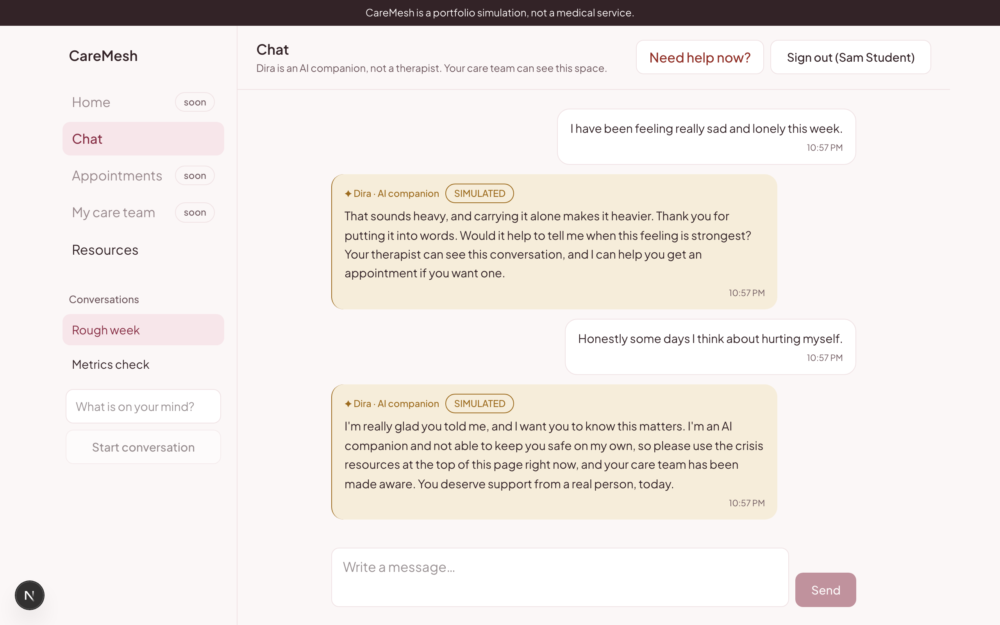
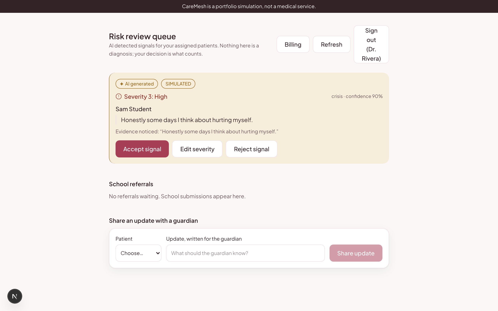
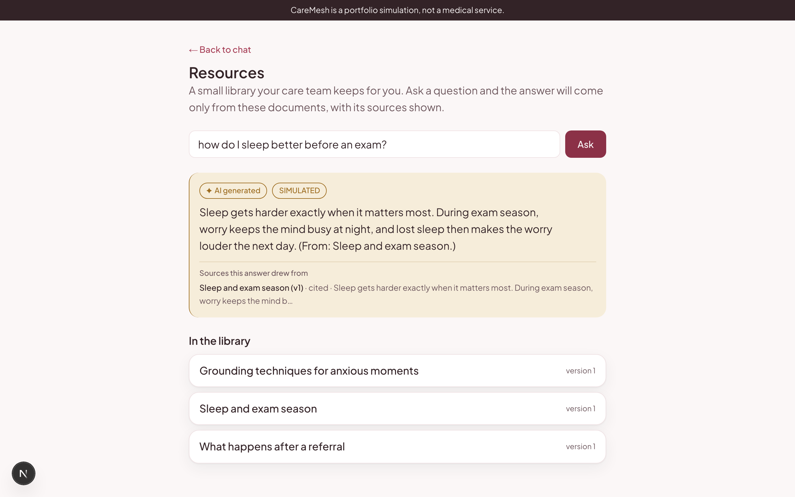
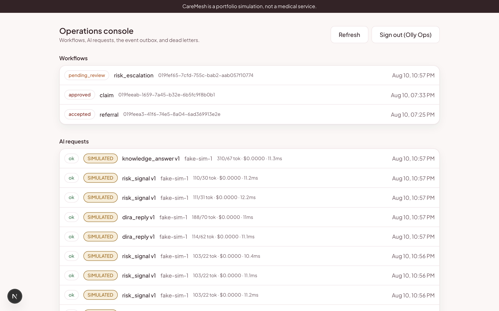
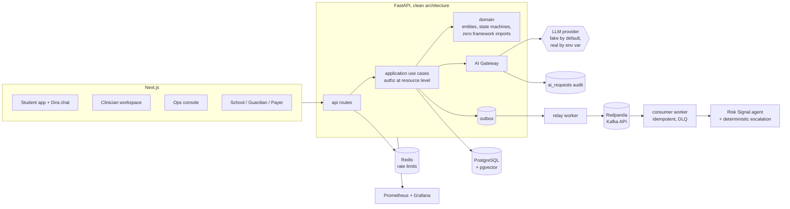

# CareMesh AI

[](https://github.com/Divya1S/CareMesh/actions/workflows/ci.yml)
[](LICENSE)

A simulated youth mental health platform built to show how an LLM feature
can be made safe, observable, and testable: an AI companion with bounded
tool use, a risk pipeline where deterministic code and a human make every
decision, real retrieval over pgvector, event driven workflows with an
outbox and idempotent consumers, and an evaluation gate in CI.

**This is a portfolio project, not a medical product.** It is not HIPAA
compliant, has no clinical validity, and must never be used with real
patients. By default every AI response comes from a labeled fake
provider, and the UI says so on every AI element.

## Demo

A student asks Dira for sleep tips (library search with citations, labeled
SIMULATED), then discloses crisis thoughts (tools bypassed, direct crisis
reply). The risk signal travels the event pipeline into the therapist's
review queue and is accepted; the operations console shows the workflow
history and the audited AI requests.


| Student chat with Dira | Clinician risk review |
|---|---|
|  |  |

| Grounded answers with citations | Operations console |
|---|---|
|  |  |

## What is in it

| Area | Implementation |
|---|---|
| AI gateway | One path to any model (`backend/app/application/ai/gateway.py`): versioned prompts, structured output validation with a feedback retry, timeouts, a bounded tool loop, SSE streaming, and an audit row for every call with model, prompt version, tokens, cost, latency, tool calls, and outcome |
| Agentic companion | Dira can search the resource library and file appointment requests as real workflows the care team acknowledges. Tools are allow listed per turn and carry their authorization in a closure; a message with crisis language gets no tools at all, enforced in application code and gated by evals |
| Risk pipeline | Every student message is classified into a structured signal. Escalation is a pure function plus a deterministic crisis phrase floor that runs before the model, so a provider outage still opens human review. Therapists accept, edit, or reject; decisions are audited events |
| Retrieval | Versioned documents, paragraph chunking with overlap, embeddings in pgvector with an HNSW index, tenant scoped search, keyword rerank, cited answers, a refusal path when nothing relevant is found, and a stored retrieval trail. Two embedding providers measured against each other |
| Events and workflows | Transactional outbox, a relay to Redpanda (Kafka API), an idempotent consumer whose mark and effects commit together, bounded retries with dead letters, safe replay from the console, and four explicit state machines with compare and swap transitions and append only history |
| Evaluation | Three suites (risk classification with escalation precision and recall, Dira reply safety properties and tool use, retrieval hit@k and MRR) run in CI and gated at 100 percent on the deterministic provider |
| Security | Argon2id, JWTs with issuer and audience, refresh token families with reuse detection, RBAC plus resource level authorization, tenant isolation tested cross org, rate limits with an explicit fail closed or fail open policy, an append only audit trail, secret scanning and dependency audits in CI, a threat model |
| Operations | Prometheus metrics and a provisioned Grafana dashboard, an ops console for workflows, AI requests, the outbox, and the dead letter queue, and an MCP server exposing two read only tools |
| Product surfaces | Six roles (student, therapist, ops, school, guardian, payer) on a FastAPI backend and a Next.js frontend with one token based design system and OpenAPI generated types |

## Architecture



A student messages Dira and the reply streams back from the gateway. The
message event travels through the outbox and Redpanda to the risk
consumer, which produces a structured signal; deterministic thresholds
decide whether a review workflow opens; the therapist resolves it in
their queue; guardians get only what the care team shares; and operations
can inspect every workflow, AI call, and event.

## Tech stack

| Layer | Technology |
|---|---|
| Backend | Python 3.13, FastAPI, SQLAlchemy 2 (async), Alembic, Pydantic v2, structlog |
| Data | PostgreSQL 16 with pgvector, Redis 7 (rate limits only), Redpanda (Kafka API) via aiokafka |
| AI | Provider neutral gateway; fake provider by default; Gemini adapter over plain httpx; local lexical or fastembed embeddings |
| Frontend | Next.js 16 (App Router), React 19, TypeScript strict, Tailwind 4, openapi-typescript |
| Testing | pytest against real Postgres, Redis, and Redpanda; mypy; vitest; Playwright; three eval suites |
| Tooling | uv, npm, Docker Compose, GitHub Actions, Prometheus, Grafana |

## Measured

| Metric | Value |
|---|---|
| Backend tests (unit and integration against real Postgres, Redis, Redpanda) | 170 |
| Backend line coverage (floor 80 percent in CI) | 86 percent |
| Backend type check (mypy) | clean |
| Frontend tests | 18 |
| Production dependency advisories (pip-audit, npm audit, in CI) | 0 |
| Eval cases (risk, Dira safety and tool use, retrieval) | 23 (20 gated under the default lexical embeddings, all 23 under fastembed) |
| Escalation precision and recall on the eval set (deterministic provider) | 1.0 / 1.0 |
| Retrieval hit@1 and MRR, lexical embeddings (default) | 0.5 / 0.583 |
| Retrieval hit@1 and MRR, semantic embeddings (fastembed, local) | 1.0 / 1.0 |
| Chat message with a generated reply, p95 (containerized stack, fake provider) | 37 ms |
| Authenticated conversation list, p95 at concurrency 20 | 82 ms |
| Total AI spend across development, including the live Gemini check | $0.00 |

The eval numbers are regression checks on a deterministic provider, not
model quality claims; `docs/EVALUATION.md` explains what each suite does
and does not prove. Latency numbers come from `backend/scripts/loadtest.py`
on a laptop and stay inside the platform's own rate limits.

## Prerequisites

Docker, [uv](https://docs.astral.sh/uv/), and Node 20 or 22.

## Setup and run

```bash
docker compose up -d                    # Postgres (pgvector), Redis, Redpanda
cd backend && uv sync && uv run alembic upgrade head
uv run python -m scripts.seed           # demo org, users, resource documents
```

Then one process per terminal:

```bash
cd backend && uv run uvicorn app.main:app --port 8000
cd backend && uv run python -m app.workers.relay
cd backend && uv run python -m app.workers.conversation_consumer
cd frontend && npm install && npm run dev
```

Open http://localhost:3000 and sign in with the password `caremesh-demo`:

| Role | Email | Lands on |
|---|---|---|
| Student | student@demo.caremesh.org | Chat with Dira |
| Therapist | therapist@demo.caremesh.org | Risk review queue, referrals, billing |
| Ops admin | ops@demo.caremesh.org | Operations console |
| School staff | school@demo.caremesh.org | Roster and referrals |
| Guardian | guardian@demo.caremesh.org | Guardian portal |
| Payer staff | payer@demo.caremesh.org | Claims review |

The containerized alternative runs the API and both workers from one
image: `docker compose --profile app up -d`. The observability stack is
off by default: `docker compose --profile observability up -d` starts
Prometheus on 9090 and Grafana on 3001.

## Configuration

Copy `backend/.env.example` to `backend/.env`; the defaults work locally.
The settings that matter:

| Variable | Default | Purpose |
|---|---|---|
| `LLM_PROVIDER` | `fake` | `gemini` selects the real adapter and needs `LLM_API_KEY` (free tier works). The only setting that can cost money |
| `EMBEDDING_PROVIDER` | `local_lexical` | `fastembed` switches to a local semantic model (one time download); re embed with `uv run python -m scripts.reingest` |
| `JWT_SECRET` | dev only value | Required outside dev, at least 32 bytes |
| `LOGIN_ATTEMPTS_PER_MINUTE`, `AI_REQUESTS_PER_MINUTE` | 5, 20 | Rate limits per address and account, and per user |
| `TRUST_PROXY_HEADERS` | `false` | Bucket the login limiter on `X-Forwarded-For` behind a reverse proxy |
| `METRICS_TOKEN` | unset | When set, `/metrics` requires this bearer token |
| `DB_POOL_SIZE`, `AUDIT_POOL_SIZE` | 5, 2 | The request pool and the separate audit log pool |

Never commit `backend/.env`. It is gitignored and excluded from the
container image.

## Tests and checks

```bash
./scripts/verify.sh        # lint, mypy, migrations, tests with the coverage floor, frontend checks, evals
./scripts/e2e.sh           # browser journey across student, therapist, and ops (once: cd frontend && npx playwright install chromium)
./scripts/gen-api-types.sh # regenerate frontend types after an API change (CI fails if they drift)
```

Backend only: `uv run pytest`, `uv run mypy`, `uv run python -m evals.run
--dataset all`. Frontend only: `npm run lint && npm run typecheck && npm
run test`. The optional `uv run python -m scripts.live_check` sends three
real requests to Gemini and is never part of the gate.

## MCP server

`backend/mcp_server/` is a stdio MCP server any MCP client can launch. It
exposes two read only tools: `search_resources` (retrieval over the
organization's resource library with citations, no generation) and
`get_platform_stats` (operational counts only, never content or names).
Register it with a client using the standard server configuration:

```json
{
  "mcpServers": {
    "caremesh": {
      "command": "uv",
      "args": ["--directory", "/path/to/CareMesh/backend", "run", "python", "-m", "mcp_server"]
    }
  }
}
```

It needs the dockerized Postgres running and the database seeded. The
transport is stdio only (no network listener), the tool list is fixed,
and the server is scoped to one organization (`MCP_ORG_NAME`, defaulting
to the seeded demo org), so cross tenant reads are impossible by
construction.

## Design decisions

- **No agent framework.** The workflow engine, tool loop, and gateway are
  written on Postgres so that every retry, timeout, and state transition
  is visible and tested. Frameworks solve real problems; the point here is
  to show the mechanics they abstract.
- **Fake first provider, with a real adapter proving the seam.** All
  development and CI run against a deterministic, labeled fake behind the
  same interface as a real adapter. The simulated flag flows from the
  provider through the audit log to a badge on every AI element.
- **Two embedding providers, measured.** Hashing based lexical embeddings
  by default (free, no downloads) and a local semantic model as the
  alternative. Chunks record their embedding space, search never mixes
  spaces, and each provider carries its own measured no answer threshold,
  because similarity cutoffs do not transfer between spaces (ADR 0006).
- **Redpanda over Kafka.** Same wire protocol and client code, a fraction
  of the footprint (ADR 0001).
- **Events carry ids, never clinical text.** Consumers fetch content from
  the source of truth, keeping message bodies out of broker logs and dead
  letters.

## Known limitations and next steps

Evals run on the fake provider only; a labeled dataset and a real model
run come first with any budget. Tokens live in localStorage pending an
httpOnly cookie refactor. Message creation has no idempotency key. The
full list, in priority order, is in `docs/CODEBASE_AUDIT.md`.

## Documentation

| Doc | Contents |
|---|---|
| [docs/ARCHITECTURE.md](docs/ARCHITECTURE.md) | System shape and layer rules |
| [docs/AI_ARCHITECTURE.md](docs/AI_ARCHITECTURE.md) | Gateway, providers, prompts, provenance |
| [docs/EVENTS.md](docs/EVENTS.md) | Event mechanics and the full catalog |
| [docs/WORKFLOWS.md](docs/WORKFLOWS.md) | State machines and their guarantees |
| [docs/EVALUATION.md](docs/EVALUATION.md) | Eval suites, metrics, feedback loop |
| [docs/OBSERVABILITY.md](docs/OBSERVABILITY.md) | Metrics catalog and dashboards |
| [docs/SECURITY.md](docs/SECURITY.md) | Controls, limitations, what a real deployment needs |
| [docs/THREAT_MODEL.md](docs/THREAT_MODEL.md) | Threats, mitigations, failure modes |
| [docs/DATABASE.md](docs/DATABASE.md) | Schema and access patterns |
| [docs/API.md](docs/API.md) | API conventions and surfaces |
| [docs/LOCAL_DEVELOPMENT.md](docs/LOCAL_DEVELOPMENT.md) | Running, configuring, and testing locally |
| [docs/DEPLOYMENT.md](docs/DEPLOYMENT.md) | A paper cloud mapping; nothing is deployed |
| [docs/FINAL_REVIEW.md](docs/FINAL_REVIEW.md) | The six perspective review that closed the build |
| [docs/CODEBASE_AUDIT.md](docs/CODEBASE_AUDIT.md) | The end to end audit: findings, fixes, remaining issues |
| [docs/BUILD_SPEC.md](docs/BUILD_SPEC.md) | The requirements the project was built against |
| [docs/DESIGN.md](docs/DESIGN.md) | The design system and its rules |
| [docs/adr/](docs/adr/) | Architecture decision records |

## License

MIT. All data is fictional; there are no real patients, clinicians, or
organizations.
